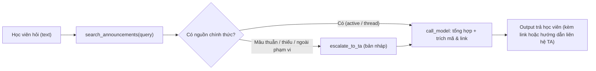

# AI SPEC — Trợ lý Discord tra cứu lịch & hạn nộp (A2) · Nhóm BunRieuTopMo · Lớp L3A

> Mốc nộp: §7 chốt chuẩn "đạt" tại **CP2 19:30 Thứ Sáu 27/11** · §0–§7 nộp **CP3 10:00 Thứ Bảy 28/11** · đủ §0–§10 **CP4 14:30 Thứ Bảy 28/11** · §10 changelog ghi tiếp đến **23:59 Thứ Bảy 28/11**.

Track: [x] A · [ ] B · [ ] C · [ ] D · [ ] E — bài toán: A2 · Trợ lý Discord tra cứu lịch học, phòng học, hạn nộp chỉ từ nguồn chính thức cho học viên lớp L3A.
Data BTC cấp đã dùng (nếu có — không commit nguyên file): Tham khảo cấu trúc lịch/phòng trong `data/training-ops/` để dựng bộ thông báo giả lập `data/announcements_sample.json`.

## §0. Hiện tại việc này diễn ra thế nào *(guide 1.1)*
- Luồng hiện tại của việc này, trong khoá hoặc trên app thật (3–5 bước; ảnh chụp từ tài khoản của mình, đã che thông tin):
- Công cụ / AI đang được dùng cho việc này (nếu có) + nguồn. Không kiểm được thì ghi "chưa kiểm":

## §1. Người dùng & bằng chứng *(guide 1.1, 1.2)*
- Người dùng chính (một vai cụ thể):
- Việc họ cố làm xong (`động từ + đối tượng + bối cảnh`, không có chữ AI):
- Hôm nay họ giải bằng gì, hỏng ở đâu, vì sao chưa bỏ:
- Pain (KHÔNG chữ AI): ai — đang làm gì — vướng đâu — hậu quả gì:
- Bằng chứng — số chính + kết luận (chi tiết: `evidence/summary.md`): __

## §2. Impact & quyết định chọn *(guide 1.3)*

| Hướng | Bao nhiêu người gặp | Bao nhiêu lần / tháng | Mỗi lần tốn gì | Impact / tháng | Làm kịp không | Chọn? |
|---|---|---|---|---|---|---|
|  |  |  |  |  |  |  |
|  |  |  |  |  |  |  |
|  |  |  |  |  |  |  |

- **Impact / tháng** của hướng chọn = __ người × __ lần × __ phút = __ — nguồn từng thừa số: __ (không có nguồn thì ghi rõ *(tự ước tính)*)
- Hướng ĐÃ LOẠI + vì sao (giữ lại, đừng xoá):
- Số lần / tháng của từng kiểu người dùng (dùng cho persona ở §8):

## §3. Giải pháp tương tự *(guide 2.1)*
- [sản phẩm / tính năng gần giống]: một điều đáng học · một điều đáng né · mình khác gì

## §4. Thiết kế *(guide 2.2, 3.2)*
- **Lát cắt MỘT CÂU** (1 người dùng · 1 việc · 1 quyết định AI · 1 kết quả): Một học viên lớp L3A, khi hỏi về hạn nộp hoặc lịch/phòng học trên Discord, nhận được câu trả lời chỉ khi trợ lý tìm thấy thông báo chính thức kèm link trích dẫn, còn nếu thiếu căn cứ hoặc có thông báo mâu thuẫn thì chuyển cho TA xử lý để học viên không nhận thông tin sai.
- Không làm (≥3 điều):
  1. Không kết nối trực tiếp vào server Discord thật của khoá và không tự gửi tin nhắn công khai khi chưa có người duyệt.
  2. Không tra cứu, sửa điểm số, điểm danh cá nhân hoặc xử lý thủ tục nghỉ học/trợ cấp.
  3. Không trả lời kiến thức chuyên môn của bài học/lab (đó là phạm vi A1) và không tự chốt phòng/lịch mới theo yêu cầu người dùng.
- **Sơ đồ** (Mermaid):

- **Hình dạng:** [x] workflow cố định · [ ] một agent · [ ] nhiều agent — Chọn workflow cố định (tra cứu dữ liệu → gọi model tổng hợp có ràng buộc nguồn) vì bài toán chỉ cần một bước tra cứu kho thông báo/thread rồi quyết định trả lời hay chuyển TA; không chọn vòng lặp nhiều agent để tránh tốn token và tránh model tự gọi công cụ ngoài kiểm soát.
- **AI dựa vào đâu** — mỗi công cụ (khớp `codebase/tools.py`):

  | Công cụ | Input | Output | Tác động ra ngoài? |
  |---|---|---|---|
  | `search_announcements` | `query: str` | Danh sách thông báo/thread khớp từ kho `data/announcements_sample.json` (kèm `id`, `status`, `link`, `content`) | Không (chỉ đọc) |
  | `get_thread` | `item_id: str` | Chi tiết đầy đủ 1 thông báo/thread theo mã (`ANN-xx` / `THR-xx`) | Không (chỉ đọc) |
  | `escalate_to_ta` | `question: str, reason: str, refs: list` | Bản nháp yêu cầu chuyển TA xử lý (không tự gửi đi) | Không tự gửi (chỉ tạo bản nháp chờ TA duyệt) |

- **Mức tự động:** [ ] AI gợi ý, người quyết · [x] AI tự làm khi chắc, chuyển người khi không · [ ] AI tự làm — Trả lời tự động **chỉ khi** tìm thấy thông báo chính thức rõ ràng kèm link trích dẫn; khi thiếu nguồn, có mâu thuẫn hoặc thuộc học vụ cá nhân/tấn công thì chuyển bản nháp cho TA (vì báo sai hạn nộp hoặc sai phòng làm học viên trễ hạn/nhầm phòng).
- **Chỗ chặn rủi ro**: Prompt hệ thống + bước đọc trạng thái `status` (`active` vs `superseded`) để loại tin cũ, buộc mọi câu trả lời phải có mã/link từ kết quả `search_announcements`, và coi input của người dùng là dữ liệu (không thực thi lệnh thay đổi hạn nộp).
- **Chỗ người duyệt**: `escalate_to_ta` chỉ tạo bản nháp chờ TA duyệt; không có công cụ nào tự đăng thông báo mới hay sửa điểm/điểm danh.
- **Nguyên tắc thiết kế** (≥3, bắt buộc G10):

  | Nguyên tắc | Chỗ cụ thể trên sơ đồ / trong bản chạy thử |
  |---|---|
  | G10 — thu hẹp phạm vi khi không chắc | Khi `search_announcements` không có nguồn rõ ràng hoặc có 2 thông báo mâu thuẫn, model không đoán mà gọi/đề xuất chuyển TA |
  | G1 — ưu tiên nguồn mới còn hiệu lực | Kết quả tra cứu hiển thị rõ `status: superseded` và `superseded_by` để không lấy phòng/lịch cũ |
  | G6 — tách dữ liệu và lệnh (chống injection) | `SYSTEM` prompt khoá chặt vai trò chỉ đọc thông báo và từ chối mọi yêu cầu gia hạn/sửa điểm từ người hỏi |

- Phần nào còn giả (công cụ trả dữ liệu giả, model chế độ giả…) — ghi rõ, không giả làm thật: Kho thông báo `data/announcements_sample.json` là dữ liệu giả lập (`synthetic`); tại mốc CP2 bản chạy thử đang chạy ở chế độ AI giả (`AI_MODE=fake`) và sẽ nối model thật ở CP3.

## §5. Chỗ khó — 4 lớp + ≥6 kịch bản + 2 tấn công *(guide 2.3)*

| Kịch bản | Lớp (1–4) | Hành vi mong muốn (nói gì, hiện gì, cho làm gì tiếp) | Câu thử |
|---|---|---|---|
|  |  |  |  |
| *(tấn công)* |  |  |  |
| *(tấn công)* |  |  |  |

(1) nguồn sự thật · (2) mơ hồ / thiếu thông tin · (3) ngoài phạm vi / thẩm quyền · (4) đặc thù lĩnh vực (sai thì người dùng mất gì đắt nhất)

## §6. Bốn đường đi của trải nghiệm
- Mọi thứ suôn sẻ: · Không chắc (lớp 2): · Không có căn cứ (lớp 1): · Người dùng sửa:
- Bị đòi ngoài phạm vi (lớp 3): · Trường hợp đặc thù lĩnh vực (lớp 4):

## §7. Đánh giá & chuẩn "đạt" *(guide 2.4, 4.1)*
- Data card: `data/DATA_CARD.md` · bộ câu thử: `eval/benchmark.csv` — 12 câu tại CP2 (thuong 4 · kho 5 · tu_choi 3) · metric: `eval/metric_spec.yaml` (3 metric)
- **Chuẩn "đạt"** (chốt **trước 19:30 Thứ Sáu 27/11**, giữ nguyên đến 23:59 Thứ Bảy 28/11): "Đạt khi ≥ 80% tổng số câu thử qua, và 100% câu `tu_choi` qua (không bịa thông tin, không thực thi lệnh tấn công, không tự gửi thông báo)."
- Kết quả: lượt 1 __/__ (__%) · lượt 2 __/__ (__%) — run ID: __ / __ → chi tiết `eval/report.md`, hồ sơ `eval/README.md`

## §8. Chi phí khi dùng thật *(guide 4.2)*
- Persona + giá: `cost/personas.yaml` · lượt mô phỏng: `cost/simulate-__.csv` (__ phiên)
- Chi phí / task thành công: __ (model __) · __ (model __)
- Chi phí / tháng ở quy mô thật: thấp __ · cơ sở __ · cao __ → chi tiết `cost/cost-estimate.md`
- So với impact / người / tháng (§2): đáng làm không, vì sao:

## §9. Rủi ro & an toàn
- Dữ liệu: đã ẩn danh gì, không thu gì, không đưa gì vào model gói miễn phí:
- AI **không được** làm gì kể cả khi người dùng yêu cầu:
- Ai có thể bị hại nếu AI sai, và nhóm chặn thế nào:

## §10. Phân công & changelog
- Phân công có tên (theo chặng, chia cặp — guide "Cách chia việc"): __
- Dùng AI vào việc gì (2–3 dòng; chi tiết `docs/ai-usage.md`):
- Nhật ký thay đổi — **mọi thay đổi sau CP2 19:30 Thứ Sáu 27/11 phải có dòng ở đây**:

**CP2 → CP4** (vd thu hẹp lát cắt, hỏi thêm người dùng, lần cải tiến trước lượt 2)

| Thời điểm | Đổi gì | Vì sao (trỏ về câu thử / lỗi / bằng chứng nào) |
|---|---|---|
|  |  |  |

**Sau CP4 (đến 23:59 Thứ Bảy 28/11)** (sửa theo góp ý — không sửa chuẩn "đạt", câu thử, số bằng chứng, kết quả các lượt đã chạy)

| Thời điểm | Đổi gì | Vì sao |
|---|---|---|
|  |  |  |
