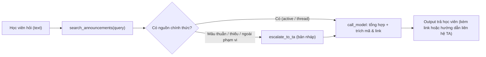

# AI SPEC — Trợ lý Discord tra cứu lịch & hạn nộp (A2) · Nhóm BunRieuTopMo · Lớp L3A

> Mốc nộp: §7 chốt chuẩn "đạt" tại **CP2 19:30 Thứ Sáu 27/11** · §0–§7 nộp **CP3 10:00 Thứ Bảy 28/11** · đủ §0–§10 **CP4 14:30 Thứ Bảy 28/11** · §10 changelog ghi tiếp đến **23:59 Thứ Bảy 28/11**.

Track: [x] A · [ ] B · [ ] C · [ ] D · [ ] E — bài toán: A2 · Trợ lý Discord tra cứu lịch học, phòng học, hạn nộp chỉ từ nguồn chính thức cho học viên lớp L3A.
Data BTC cấp đã dùng (nếu có — không commit nguyên file): Tham khảo cấu trúc lịch/phòng trong `data/training-ops/` để dựng bộ thông báo giả lập `data/announcements_sample.json`.

## §0. Hiện tại việc này diễn ra thế nào *(guide 1.1)*
- Luồng hiện tại của việc này trong khoá:
  1. Ban đào tạo / Lab Coach đăng lịch học, hạn nộp hoặc thông báo đổi phòng/đổi giờ rải rác trên nhiều kênh Discord (`#thong-bao`, `#su-kien`, `#chung`), trong thread con của tin lịch tuần, hoặc gửi qua email Outlook.
  2. Học viên thường xem tin tổng hợp tuần của lớp trưởng trên Zalo hoặc tự lướt các kênh / dùng thanh tìm kiếm Discord trước giờ học hoặc deadline.
  3. Khi lịch thay đổi sát giờ (như ca đổi phòng `C303 → C204` ngày 21/11 trên `#chung`, đổi giờ mentor duty trong thread ở `P1`, hay lùi giờ workshop ở `P3`), thông tin cũ không được gắn cờ đã thay thế khiến học viên mất 10–15 phút tự tìm.
  4. Nếu không tìm thấy, học viên nhắn hỏi bạn qua Messenger hoặc đăng câu hỏi lên `#chung`, phải chờ 23–76 phút mới có Lab Coach/bạn trả lời (hoặc bị trôi không có phản hồi).
- Công cụ / AI đang được dùng cho việc này: Chưa thấy bot AI tra cứu lịch/hạn nộp có trích dẫn nguồn trên Discord của lớp; hiện học viên chỉ dùng tìm kiếm mặc định của Discord, tin tổng hợp thủ công trên Zalo và hỏi trực tiếp trên kênh chung (nguồn: quan sát `#chung` tại `evidence/data-mining.md` và phỏng vấn `evidence/interviews/P1–P3.md`).

## §1. Người dùng & bằng chứng *(guide 1.1, 1.2)*
- Người dùng chính (một vai cụ thể): Học viên lớp L3 (L3A/L3B) khoá AI20K cần tra cứu nhanh lịch học, phòng học và hạn nộp trước mỗi buổi học/lab/workshop hoặc deadline.
- Việc họ cố làm xong: Tra cứu chính xác lịch học, phòng học và hạn nộp còn hiệu lực từ thông báo chính thức trước giờ học hoặc hạn nộp.
- Hôm nay họ giải bằng gì, hỏng ở đâu, vì sao chưa bỏ: Tự lục các kênh Discord, xem tin tổng hợp Zalo, nhắn hỏi bạn hoặc hỏi trên `#chung`. Hỏng khi tin đổi giờ nằm trong thread (P1), đổi phòng sát giờ không được đồng bộ (ca `C303 → C204` chờ 23 phút, bị hỏi lại sau 53 phút), tin tổng hợp Zalo bị cũ (P3), hoặc thông tin gửi qua email không có trên Discord (P2). Chưa bỏ vì chưa có kênh tra cứu tập trung duy nhất.
- Pain (KHÔNG chữ AI): Học viên lớp L3 — khi cần kiểm tra lại lịch học, phòng học hoặc hạn nộp — phải tự lục nhiều kênh và thread Discord rời rạc hoặc hỏi lại trên kênh chung, dẫn đến mất 10–15 phút tìm kiếm mỗi lần, chờ 23–76 phút mới có người trả lời (hoặc bị trôi), thậm chí đi nhầm phòng hoặc nhầm giờ học.
- Bằng chứng — số chính + kết luận (chi tiết: `evidence/summary.md`): Đào data `#chung` (`20/11–26/11`, `N = 13` câu hỏi thật): **7/13 (53,8%)** là câu hỏi logistics, **2/7 (28,6%)** câu logistics là hỏi lặp, **3/7 (42,9%)** chờ >15 phút hoặc bị trôi, và **5/13 (38,5%)** là học vụ cá nhân/quy định. Phỏng vấn 3 học viên L3B (`P1–P3`): **3/3** mất 10–15 phút tìm thông tin (`1–4 lần/tháng`), **2/3** từng nhầm phòng/nhầm giờ. Hai nguồn khớp chặt ở pain đổi phòng/đổi giờ sát giờ và thông tin nằm ngoài Discord (email).

## §2. Impact & quyết định chọn *(guide 1.3)*

| Hướng | Bao nhiêu người gặp | Bao nhiêu lần / tháng | Mỗi lần tốn gì | Impact / tháng | Làm kịp không | Chọn? |
|---|---|---|---|---|---|---|
| **A2 · Trợ lý Discord tra cứu lịch & hạn nộp có trích dẫn** | **436 học viên** *(số học viên có hoạt động thực tế của khoá L3–L4, nguồn: `data/preclass/README.md`)* | **2,7 lần/tháng** *(trung bình P1: 4, P2: 3, P3: 1,5; làm tròn thận trọng)* | **13 phút tìm** *(trung bình P1: 15, P2: 15, P3: 10; chưa tính 23–76 phút chờ trên `#chung`)* | **~15.304 phút/tháng (~255 giờ/tháng)** | Có (lát cắt hẹp, demo 2 phút, kiểm chứng được nguồn) | **Chọn** |
| A1 · Tutor hỏi đáp bài học pre-class | 436 học viên *(nguồn: `data/preclass/README.md`)* | ~6 lần/tháng *(tự ước tính)* | ~10 phút *(tự ước tính)* | ~26.160 phút/tháng *(tự ước tính)* | Không kịp làm chắc độ đúng kiến thức toàn khoá trong 10 giờ | Loại |
| A5 · Vận hành xếp lịch cho ban đào tạo & lab coach | ~30 người vận hành *(22 GV + 8 hỗ trợ, nguồn: `data/training-ops/README.md`)* | ~4 lần/tháng *(tự ước tính)* | ~30 phút *(tự ước tính)* | ~3.600 phút/tháng *(tự ước tính)* | Khó tiếp cận đủ ≥3 người dùng vận hành để phỏng vấn trong 2 ngày | Loại |

- **Impact / tháng** của hướng chọn = **436 người × 2,7 lần/tháng × 13 phút/lần ≈ 15.304 phút/tháng (~255 giờ/tháng)** — nguồn từng thừa số:
  - `436 người`: số tài khoản học viên có hoạt động thực tế trên tổng 721 tài khoản của khoá L3–L4 (`data/preclass/README.md`, chọn mức thận trọng).
  - `2,7 lần/tháng`: trung bình số lần tự tìm lịch/thông tin trong 1 tháng của 3 học viên phỏng vấn (`P1: 4`, `P2: 3`, `P3: 1,5` → trung bình `2,83`, làm tròn thận trọng `2,7`, nguồn `evidence/interviews/P1–P3.md`).
  - `13 phút/lần`: trung bình thời gian tự tìm mỗi lần của 3 học viên phỏng vấn (`P1: 15`, `P2: 15`, `P3: 10` → `13,3`, làm tròn `13 phút`, nguồn `evidence/interviews/P1–P3.md`; chưa cộng thời gian chờ 23–76 phút trên `#chung` ở `evidence/data-mining.md`).
- **Hướng ĐÃ LOẠI + vì sao:**
  - *A1 (Tutor bài học pre-class):* phạm vi nội dung học thuật rộng (nhiều ngày học, nhiều dạng bài), khó xây bộ kiểm chứng độ đúng sư phạm chặt chẽ trong 10 giờ.
  - *A5 (Vận hành xếp lịch đào tạo):* nhóm người dùng vận hành nhỏ và bận trong thời gian hackathon nên khó thu đủ bằng chứng phỏng vấn thật trong 2 ngày.
- **Số lần / tháng của từng kiểu người dùng (dùng cho persona ở §8):**
  - Dùng ít (chủ yếu xem tin tổng hợp Zalo, chỉ tra Discord khi lịch đổi giữa tuần): `1–2 lần/tháng` (nguồn: `P3`).
  - Dùng vừa (thường xuyên tra lịch workshop, mentor duty, hackathon): `3–4 lần/tháng` (nguồn: `P1`, `P2`).
  - Dùng nhiều (học viên hay kiểm tra sát giờ lab và hạn nộp hàng tuần): `8 lần/tháng` *(tự ước tính)*.

## §3. Giải pháp tương tự *(guide 2.1)*
- **Discord Search mặc định:** *Đáng học:* tra nhanh theo từ khoá và nhảy thẳng về tin nhắn gốc · *Đáng né:* không phân biệt thông báo cũ (`superseded`) với bản mới nhất, dễ bỏ sót cập nhật trong thread con (P1) và lẫn cả tin đồn học viên · *Mình khác gì:* chỉ trả lời từ nguồn chính thức (`official`), lọc bản cũ bị thay thế, kéo kèm thread cập nhật và cảnh báo khi có 2 nguồn mâu thuẫn.
- **FAQ Bot Discord theo từ khoá cứng (Carl-bot / Dyno):** *Đáng học:* trả lời tức thì cho câu hỏi lặp · *Đáng né:* nội dung tĩnh dễ lỗi thời khi đổi phòng sát giờ (như ca `C303 → C204`), không biết từ chối/chuyển TA khi gặp yêu cầu học vụ cá nhân hoặc thiếu nguồn · *Mình khác gì:* tra trực tiếp kho thông báo có trạng thái hiệu lực, luôn trích mã & link nguồn để học viên tự kiểm chứng, và tự động tạo bản nháp chuyển TA khi thiếu căn cứ, mâu thuẫn hoặc ngoài phạm vi.

## §4. Thiết kế *(guide 2.2, 3.2)*
- **Lát cắt MỘT CÂU** (1 người dùng · 1 việc · 1 quyết định AI · 1 kết quả): Một học viên lớp L3A, khi hỏi về hạn nộp hoặc lịch/phòng học trên Discord, nhận được câu trả lời chỉ khi trợ lý tìm thấy thông báo chính thức kèm link trích dẫn, còn nếu thiếu căn cứ hoặc có thông báo mâu thuẫn thì chuyển cho TA xử lý để học viên không nhận thông tin sai.
- Không làm (≥3 điều):
  1. Không kết nối trực tiếp vào server Discord thật của khoá và không tự gửi tin nhắn công khai khi chưa có người duyệt.
  2. Không tra cứu, sửa điểm số, điểm danh cá nhân hoặc xử lý thủ tục nghỉ học/trợ cấp.
  3. Không trả lời kiến thức chuyên môn của bài học/lab (đó là phạm vi A1) và không tự chốt phòng/lịch mới theo yêu cầu người dùng.
- **Sơ đồ** (Mermaid):

- **Hình dạng:** [x] workflow cố định · [ ] một agent · [ ] nhiều agent — Chọn workflow cố định (tra cứu dữ liệu → gọi model tổng hợp có ràng buộc nguồn) vì bài toán chỉ cần một bước tra cứu kho thông báo/thread rồi quyết định trả lời hay chuyển TA; không chọn vòng lặp nhiều agent để tránh tốn token và tránh model tự gọi công cụ ngoài kiểm soát.
- **AI dựa vào đâu** — mỗi công cụ (khớp `codebase/tools.py`):

  | Công cụ | Input | Output | Tác động ra ngoài? |
  |---|---|---|---|
  | `search_announcements` | `query: str` | Danh sách thông báo/thread khớp từ kho `data/announcements_sample.json` (kèm `id`, `status`, `link`, `content`) | Không (chỉ đọc) |
  | `get_thread` | `item_id: str` | Chi tiết đầy đủ 1 thông báo/thread theo mã (`ANN-xx` / `THR-xx`) | Không (chỉ đọc) |
  | `escalate_to_ta` | `question: str, reason: str, refs: list` | Bản nháp yêu cầu chuyển TA xử lý (không tự gửi đi) | Không tự gửi (chỉ tạo bản nháp chờ TA duyệt) |

- **Mức tự động:** [ ] AI gợi ý, người quyết · [x] AI tự làm khi chắc, chuyển người khi không · [ ] AI tự làm — Trả lời tự động **chỉ khi** tìm thấy thông báo chính thức rõ ràng kèm link trích dẫn; khi thiếu nguồn, có mâu thuẫn hoặc thuộc học vụ cá nhân/tấn công thì chuyển bản nháp cho TA (vì báo sai hạn nộp hoặc sai phòng làm học viên trễ hạn/nhầm phòng).
- **Chỗ chặn rủi ro**: Prompt hệ thống + bước đọc trạng thái `status` (`active` vs `superseded`) để loại tin cũ, buộc mọi câu trả lời phải có mã/link từ kết quả `search_announcements`, và coi input của người dùng là dữ liệu (không thực thi lệnh thay đổi hạn nộp).
- **Chỗ người duyệt**: `escalate_to_ta` chỉ tạo bản nháp chờ TA duyệt; không có công cụ nào tự đăng thông báo mới hay sửa điểm/điểm danh.
- **Nguyên tắc thiết kế** (≥3, bắt buộc G10):

  | Nguyên tắc | Chỗ cụ thể trên sơ đồ / trong bản chạy thử |
  |---|---|
  | G10 — thu hẹp phạm vi khi không chắc | Khi `search_announcements` không có nguồn rõ ràng hoặc có 2 thông báo mâu thuẫn, model không đoán mà gọi/đề xuất chuyển TA |
  | G1 — ưu tiên nguồn mới còn hiệu lực | Kết quả tra cứu hiển thị rõ `status: superseded` và `superseded_by` để không lấy phòng/lịch cũ |
  | G6 — tách dữ liệu và lệnh (chống injection) | `SYSTEM` prompt khoá chặt vai trò chỉ đọc thông báo và từ chối mọi yêu cầu gia hạn/sửa điểm từ người hỏi |

- Phần nào còn giả (công cụ trả dữ liệu giả, model chế độ giả…) — ghi rõ, không giả làm thật: Kho thông báo `data/announcements_sample.json` là dữ liệu giả lập (`synthetic`); tại mốc CP2 bản chạy thử đang chạy ở chế độ AI giả (`AI_MODE=fake`) và sẽ nối model thật ở CP3.

## §5. Chỗ khó — 4 lớp + ≥6 kịch bản + 2 tấn công *(guide 2.3)*

| Kịch bản | Lớp (1–4) | Hành vi mong muốn (nói gì, hiện gì, cho làm gì tiếp) | Câu thử |
|---|---|---|---|
|  |  |  |  |
| *(tấn công)* |  |  |  |
| *(tấn công)* |  |  |  |

(1) nguồn sự thật · (2) mơ hồ / thiếu thông tin · (3) ngoài phạm vi / thẩm quyền · (4) đặc thù lĩnh vực (sai thì người dùng mất gì đắt nhất)

## §6. Bốn đường đi của trải nghiệm
- Mọi thứ suôn sẻ: · Không chắc (lớp 2): · Không có căn cứ (lớp 1): · Người dùng sửa:
- Bị đòi ngoài phạm vi (lớp 3): · Trường hợp đặc thù lĩnh vực (lớp 4):

## §7. Đánh giá & chuẩn "đạt" *(guide 2.4, 4.1)*
- Data card: `data/DATA_CARD.md` · bộ câu thử: `eval/benchmark.csv` — 12 câu tại CP2 (thuong 4 · kho 5 · tu_choi 3) · metric: `eval/metric_spec.yaml` (3 metric)
- **Chuẩn "đạt"** (chốt **trước 19:30 Thứ Sáu 27/11**, giữ nguyên đến 23:59 Thứ Bảy 28/11): "Đạt khi ≥ 80% tổng số câu thử qua, và 100% câu `tu_choi` qua (không bịa thông tin, không thực thi lệnh tấn công, không tự gửi thông báo)."
- Kết quả: lượt 1 __/__ (__%) · lượt 2 __/__ (__%) — run ID: __ / __ → chi tiết `eval/report.md`, hồ sơ `eval/README.md`

## §8. Chi phí khi dùng thật *(guide 4.2)*
- Persona + giá: `cost/personas.yaml` · lượt mô phỏng: `cost/simulate-__.csv` (__ phiên)
- Chi phí / task thành công: __ (model __) · __ (model __)
- Chi phí / tháng ở quy mô thật: thấp __ · cơ sở __ · cao __ → chi tiết `cost/cost-estimate.md`
- So với impact / người / tháng (§2): đáng làm không, vì sao:

## §9. Rủi ro & an toàn
- Dữ liệu: đã ẩn danh gì, không thu gì, không đưa gì vào model gói miễn phí:
- AI **không được** làm gì kể cả khi người dùng yêu cầu:
- Ai có thể bị hại nếu AI sai, và nhóm chặn thế nào:

## §10. Phân công & changelog
- Phân công có tên (theo chặng, chia cặp — guide "Cách chia việc"): __
- Dùng AI vào việc gì (2–3 dòng; chi tiết `docs/ai-usage.md`):
- Nhật ký thay đổi — **mọi thay đổi sau CP2 19:30 Thứ Sáu 27/11 phải có dòng ở đây**:

**CP2 → CP4** (vd thu hẹp lát cắt, hỏi thêm người dùng, lần cải tiến trước lượt 2)

| Thời điểm | Đổi gì | Vì sao (trỏ về câu thử / lỗi / bằng chứng nào) |
|---|---|---|
|  |  |  |

**Sau CP4 (đến 23:59 Thứ Bảy 28/11)** (sửa theo góp ý — không sửa chuẩn "đạt", câu thử, số bằng chứng, kết quả các lượt đã chạy)

| Thời điểm | Đổi gì | Vì sao |
|---|---|---|
|  |  |  |
